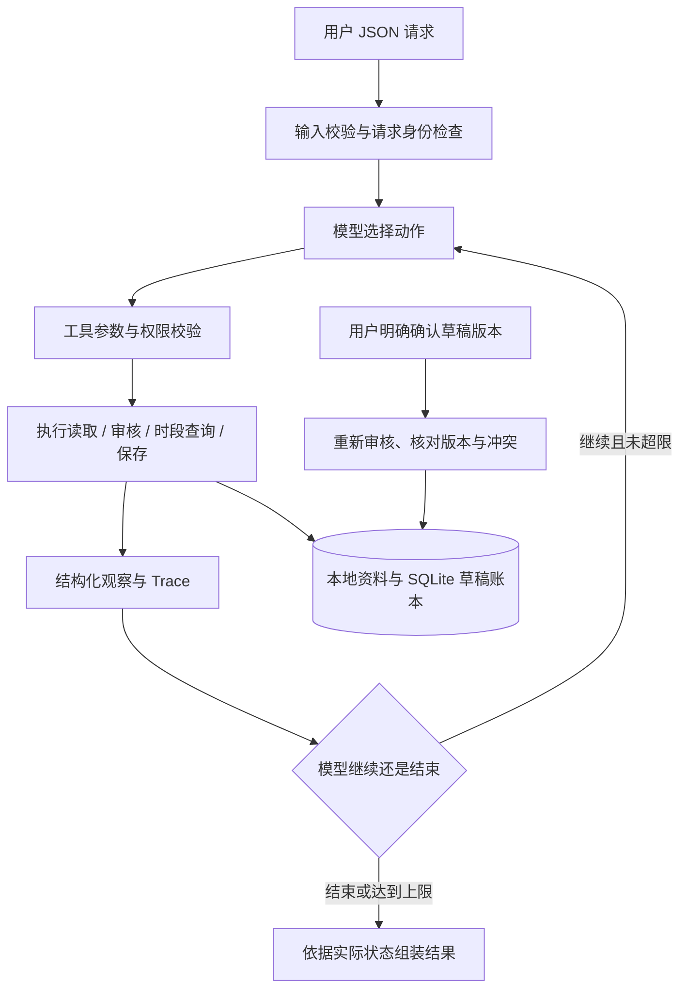

# 总体方案（设计稿）

状态：完整 Agent 的设计方案；M1 领域及 M2 工具/持久化已有实现，实际进度见 M2-ACCEPTANCE。本文完整模型循环尚未实现，设计流程不能作为模型运行证据。

## 1. 解决的问题

内容团队输入一批素材及发布时间要求。系统读取素材、核对规则、检查已有占用，再形成每项素材的审核结论与排期草稿。出现资料缺口、风险、冲突或工具错误时，模型根据真实工具结果选择补查、替代时段、请求确认或停止。

核心交付是可检查的业务结果及其证据：每项素材的风险、原始要求、建议时间、待确认事项、草稿状态与保存状态。

## 2. 总体流程

确认从独立的用户入口发起。模型工具目录中不存在“用户同意”“发布”或直接写数据库的动作。

## 3. 模型与确定性代码的职责

|决策或检查|负责方|理由|
|---|---|---|
|先处理哪项素材、是否补查、如何查询替代|模型|依赖观察结果动态选择|
|风险分类与证据生成|规则工具|保证规则版本、字段与结论能逐项核对|
|规则之外的疑点|模型可提出待确认说明|不能把主观判断升级为授权或已验证事实|
|时间比较、渠道冲突、可选窗口|业务规则|可重复验证，避免语言计算偏差|
|是否已获得同意|确认记录与草稿状态|不能依赖模型声称用户同意|
|幂等、写入、并发控制|存储事务|防止重复写入和查询后抢占|
|最终保存状态、任务状态|结果组装模块|直接依据存储和实际执行结果|
|建议解释|模型的简短理由 + 工具证据|解释必须能追溯到当前观察|

正常路径中也必须存在模型拿到工具结果后再次选择动作。脚本按固定顺序调用工具、再补一份“决策日志”，不能作为真实模型 ReAct 证明。

## 4. 两条关键路径

### 无风险且时段空闲

模型读取 M01 → 规则工具返回 PASS → 模型查询目标时段 → 返回空闲 → 模型选择保存 → 保存事务再次检查 → 返回 READY 草稿 → 模型结束。

### 硬性时段被占用

模型读取 M01 → 审核 PASS → 查询 18:00 → 返回已占用 → 模型查询替代时段 → 返回 19:00 空闲 → 模型选择保存建议 → 保存 PENDING_CONFIRMATION 草稿，保留 18:00 原要求 → 请求用户确认。

若用户确认草稿当前版本，确认事务再次查冲突。19:00 若已被其他请求占用，则确认失败，返回需要重新规划；不会按旧查询强行占用。

## 5. 技术选择与取舍

|选择|当前设计|替代方案与取舍|
|---|---|---|
|语言|Python 3.13.x|开发与独立 wheel 环境均已验证；见 M2 验收|
|入口|CLI + JSON，核心完成后补本地网页|CLI 保留复现能力；网页与 CLI 共享同一应用用例|
|执行器|原生、单 Agent、有界工具循环|职责和 Trace 明确；框架没有直接必需能力，暂不引入|
|存储|SQLite|具备持久化、唯一约束与本地事务；本项目无需外部数据库|
|规则|版本化合成元数据与文案规则|返回字段/原文证据；不代表视觉审核或完整内容安全能力|
|模型|可替换的模型接口|真实兼容接口与离线 Mock 共用执行器；Mock 明确标注|
|时间|带 UTC 偏移的 ISO 8601 时间|按 UTC 比较，保留用户偏移显示；首版不提供自然语言时间或 DST 推断|
|验证|确定性测试 + 本地集成 + 模型实际回放|分别证明规则、协议、真实决策，三者不互相替代|

未来真实模型适配参考 [OpenAI 官方 Function calling 文档](https://developers.openai.com/api/docs/guides/function-calling)。采用兼容协议是接入设计，不构成任何第三方服务兼容性或模型效果证明。用户已选择稍后配置真实模型。

## 6. 详细设计索引

- [模块与依赖](design/architecture.md)
- [数据与工具契约](design/contracts.md)
- [模型循环与执行预算](design/agent-loop.md)
- [审核、草稿与确认生命周期](design/lifecycle.md)
- [持久化、幂等、并发与恢复](design/persistence.md)
- [信任与故障处理](design/trust-and-failures.md)
- [验收与证据计划](design/test-plan.md)
- [元数据与文案审核](design/content-review.md)
- [本地网页工作台](design/workbench.md)
- [图片与视频扩展边界](design/media-extension.md)
- [完整工具 Schema](design/tool-schemas.md)
- [提示与观察协议](design/model-prompt.md)
- [合成规则、标准输入与预期投影](design/design-fixtures.md)

## 7. 刻意控制的范围

不接真实发布、不引入多 Agent、不要求线上部署，不实现视频视觉审核、多租户认证或外部发布平台同步。优先完成可验证的单机草稿闭环。

这些取舍不影响以后扩展，但首版不得把本地草稿占用描述成真实平台已经锁定时段。

## 8. 公开示例的参考范围

已补读题面指定的公开示例，并记录 [来源版本、逐项对照与未实现项](REFERENCE-REVIEW.md)。本项目保留排期业务的独立设计，参考示例的目录、评审导航和证据组织。没有引入其固定模板代码，也没有复用其测试通过结论。
