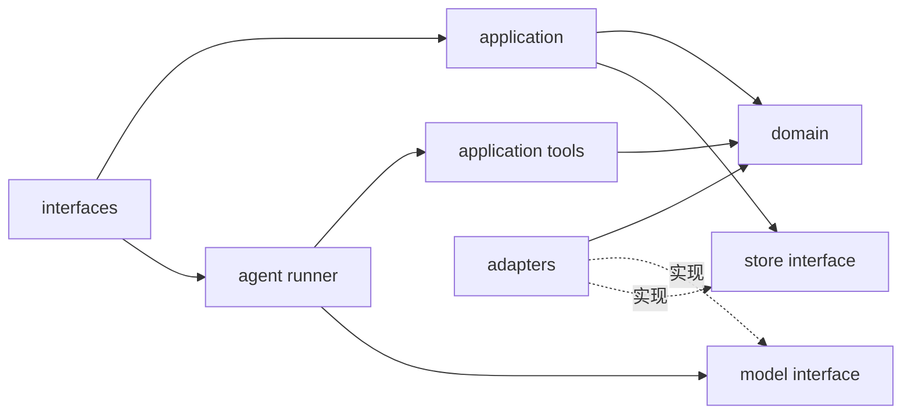

# 仓库与模块架构（设计稿）

## 1. 设计目标

把复杂业务约束收在小而稳定的接口后面，让正常运行、故障注入和评审通过同一接口观察行为。当前仅创建目录；下表中的文件均为未来拟实现文件。

## 2. 模块职责

|目录|拟实现文件|职责|禁止承担的职责|
|---|---|---|---|
|`domain/`|`requests.py`, `review.py`, `scheduling.py`, `drafts.py`|请求约束、审核规则、时间冲突、草稿状态迁移|网络调用、CLI、数据库连接|
|`application/`|`tools.py`, `confirmation.py`, `results.py`|工具用例、事务编排、用户确认、可信结果组装|模型私有协议、直接输出“已发布”|
|`agent/`|`runner.py`, `decisions.py`, `tool_catalog.py`, `trace.py`, `prompt.py`|选择动作的循环、执行预算、工具白名单、观察历史与 Trace|自行写草稿、伪造授权|
|`adapters/`|`sqlite_store.py`, `fixture_loader.py`, `compatible_model.py`, `mock_model.py`, `faults.py`|SQLite、合成资料导入、真实/Mock 模型、故障注入|绕开业务校验修改草稿|
|`interfaces/`|`cli.py`, 后续 `http.py`, `web/`|CLI 输入输出、本地 HTTP/静态页面、可信用户操作|决定风险可否放行、擅改时间或复制业务逻辑|

每个目录最初保持少量文件，只有职责实际增大时再拆分。预留文件名不要求机械照搬。

## 3. 依赖方向

- `domain` 不依赖其他项目模块。
- Agent 依赖工具目录与统一模型接口，不能导入存储实现来直接改状态。
- `application` 通过存储接口完成事务；SQLite 的连接和锁细节由适配器隐藏。
- CLI 在组合入口中创建具体适配器，传入应用用例和执行器。

## 4. 关键接口及其必须保证的行为

### 模型接口

输入：系统约束、请求、实际观察历史、当前工具目录、剩余预算。输出：一个结构化动作或协议错误。

真实模型与离线 Mock 是两个明确不同的适配器；调用方无需改变工具执行逻辑。接口不能把 Mock 的动作标成真实模型输出。

### 工具执行接口

输入：动作名、严格校验的参数、当前运行上下文。输出：成功或错误观察及摘要。

工具执行器控制白名单、参数和调用次数；模型没有任意代码、SQL、网络地址或确认能力。

### 草稿存储接口

调用方只需理解“按请求项保存草稿”“按版本确认”“重新核验并查询草稿”。实现负责原子检查、唯一性、版本、占用及审计。避免让应用代码分别执行“检查占用”和“裸写一行”。

首版只有 SQLite 实现，不为尚不存在的数据库新增空适配器。

### 本地网页接口

CLI 核心完成后接入本地 HTTP 与静态页面，直接复用应用用例和执行器，不用 shell 拼接 CLI。接口设计、确认与刷新行为见 [workbench](workbench.md)。前端不接触模型密钥，不自行修改保存状态。

### 结果组装接口

根据最新审核、草稿与错误事实产生标准输出。模型提交的结束文本只作为建议说明，不作为保存、确认或完成状态的来源。

## 5. 数据流

1. 合成 JSON 经过校验导入 SQLite，成为本次运行的资料与规则事实。
2. CLI 解析请求、确认请求身份，创建运行 ID。
3. 执行器把实际工具观察交给模型；写工具只能经应用用例调用。
4. 保存/确认事务读取当前资料、规则及占用，再持久化草稿、占用和审计。
5. Trace 记录动作与观察；结果输出引用草稿事实和 Trace。

原始 JSON 是可版本控制的合成输入；SQLite 是运行时事实源。编辑 JSON 文件不会静默改变正在运行的账本，必须执行显式导入。

## 6. 测试目录职责

|目录|验证重点|是否依赖真实模型|
|---|---|---|
|`tests/unit/`|时间重叠、规则判定、状态迁移、指纹归一化|否|
|`tests/integration/`|临时 SQLite、并发写入、回滚、协议模拟服务|否|
|`tests/acceptance/`|完整输入到实际结果，六个必验及确认闭环|分离离线与真实运行|
|`tests/adversarial/`|伪造成功、跳过审核、越权确认、提示注入、循环|确定性替身为主|

测试应穿过实际模块接口验证行为。不可只验证一个函数返回了写死的状态。

## 7. 当前架构交付边界

M1 已实现 domain 与合成资料加载适配器，详见 [M1 验收](../M1-ACCEPTANCE.md)。应用工具、数据库、Agent/CLI 和网页仍待后续阶段；目录存在不代表功能完成。
